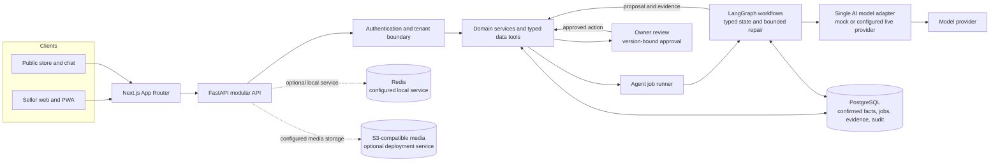

<div align="center">

# BizSaathi

### Evidence-grounded AI co-pilot for small sellers

**AI proposes. Deterministic controls validate. Sellers approve.**

[](https://nextjs.org/)
[](https://react.dev/)
[](https://www.typescriptlang.org/)
[](https://tailwindcss.com/)
[](https://www.python.org/)
[](https://fastapi.tiangolo.com/)
[](https://docs.pydantic.dev/)
[](https://www.sqlalchemy.org/)
[](https://www.langchain.com/langgraph)
[](https://www.postgresql.org/)
[](https://redis.io/)
[](https://www.docker.com/)
[](https://pytest.org/)

[Architecture](#system-architecture) · [Technology](#technology) · [Operational metrics](#operational-metrics) · [Verification](#verification-report) · [Repository map](#repository-map)

</div>

---

BizSaathi helps sellers prepare product information, customer replies, and content drafts. The database is the source of confirmed facts; generated content stays a proposal until validated and approved. The product is human-supervised: it does not autonomously publish, confirm payments, or change policy.

## System architecture



The backend is organized as a modular monolith. Tenant identity is derived server-side; product, stock, price, and policy facts are retrieved from tenant-scoped records. The graph records observable node outcomes and durations, while raw reasoning is excluded from traces. Approval is separate from proposal generation. Optional services in the diagram are not proof that a cloud deployment exists.

For detailed design, conditional workflow diagrams, and documented decisions, see [docs/01-architecture.md](docs/01-architecture.md), [docs/00-vision.md](docs/00-vision.md), and [docs/adr/](docs/adr/).

## Technology

| Layer | Technologies |
|---|---|
| Web and PWA | Next.js App Router, React, TypeScript, Tailwind CSS |
| API and validation | Python 3.12, FastAPI, Pydantic v2 |
| Workflow | LangGraph, typed state, bounded retries and repair |
| Persistence | PostgreSQL, SQLAlchemy 2, Alembic; Redis and S3-compatible storage are configured for local/deployment use |
| AI | One server-side adapter; mock by default, live provider only when explicitly configured |
| Quality | pytest, Ruff, mypy, ESLint, OpenAPI/contract checks, deterministic mock evaluations |

The checked-in [OpenAPI contract](contracts/openapi.json) is the API/web source of truth. Verified dependency versions and assumptions are maintained in [docs/12-assumptions-risks-deps.md](docs/12-assumptions-risks-deps.md). A configured provider, container, or integration is not evidence that it is deployed or live.

## Operational metrics

`GET /v1/metrics/agents?days=30` reports **observed, tenant-scoped** operational data for the signed-in owner or operator over a 1-90 day window:

- Job counts by status and succeeded/terminal-job ratio.
- Job and graph-node execution duration p50/p95, plus node execution and error-event counts.
- Model-call totals recorded by workflow state.
- Token counts and estimated provider cost are returned as `null` until actual usage and pricing data are available. No tokens, dollar amounts, or savings are fabricated.

These are operational metrics, not business-impact claims. The current repository does not contain a matched manual-versus-assisted timing baseline, production usage sample, provider billing data, or user study. Therefore **time saved and cost saved are not measured**. Mock evaluation runs make no live provider calls; their zero provider usage is not evidence of savings compared with a live workflow.

### Business and production outcomes

| Metric | Current status | Evidence needed |
|---|---|---|
| Time saved | **Not measured** | Matched manual-versus-assisted workflow timings, including seller review and corrections |
| Cost saved | **Not measured** | Comparable labor, actual model/API billing, and allocated hosting/storage cost |
| Production performance | **Not measured** | Production traffic and service telemetry; local builds and fixture timings are not production measurements |
| Live-model quality | **Not measured** | Approved live evaluation with labelled cases, recorded model/configuration, and separately reported results |

The metrics aggregation is tested with controlled database fixtures, including tenant isolation and percentile calculations; it has not been measured against production traffic. Mock evaluation scores describe deterministic mock plumbing only and must not be interpreted as live-model quality.

### Technical inventory

| Measure | Observed value | What it means |
|---|---:|---|
| OpenAPI contract | 49 paths / 52 HTTP operations | Generated and checked-in API surface |
| Reference SQL schema | 32 tables | Design reference, not a count of deployed tables |
| Synthetic evaluation set | 16 cases (12 dev, 4 held-out) | Mock evaluation plumbing only; not live-model quality |
| Agent catalog | 15 logical nodes | Architecture catalog; not all nodes are active in the runtime graph |
| Test coverage | Not collected | No coverage percentage is claimed |
| Time saved / cost saved | Not measured | No matched workflow or billing baseline exists |

## Run and verify

Start the local stack with `just up`, then use the repository runner:

```powershell
python scripts/runner.py check-fast
python scripts/runner.py check

Set-Location backend
uv run pytest tests/integration -q
uv run python -m app.evals.run --mode mock --split dev
uv run python -m app.evals.run --mode mock --split heldout
```

Backend tests and local service setup are described in [STARTUP_GUIDE.md](STARTUP_GUIDE.md). Keep credentials in local environment files; never commit them.

## Verification report

Validation run on 2026-11-03 against the local working tree. Results distinguish test evidence from design targets and mock-only evaluations.

| Check | Latest result |
|---|---|
| Backend unit tests | **236 passed, 0 failed**, 5 warnings, 5.74 s (`uv run pytest tests/unit -q`) |
| Backend integration tests | **9 passed, 0 failed, 3 skipped**, 11.55 s (`uv run pytest tests/integration -q -rs`). The three full-stack cases are marked `skipif(True)` in the test source and did not execute. |
| Backend Ruff | **Pass** (`uv run ruff check .`) |
| Backend mypy | **Pass** — 141 source files checked (`uv run mypy .`) |
| Frontend lint | **Pass** (`npm run lint`) |
| Frontend production build | **Pass** (`npm run build`); 18 pages generated |
| Repository guards | **Pass** — secret scan clean; 16 evaluation cases validated; docs consistency checked (69 API paths, 79 endpoint IDs, 32 reference-schema tables) |
| OpenAPI contract | **Pass** — generated contract matches; 49 paths / 52 HTTP operations |
| Mock evaluations | **Pass, plumbing only** — development 12/12 and held-out 4/4; not live-model quality |
| Frontend end-to-end | **Not configured** — `npm run test` reports a missing script; no frontend test files matched |

Unhandled API exceptions are logged without exception text or traceback so database connection details and other sensitive values are not copied into application logs.

The metrics endpoint and its aggregation are covered by unit and PostgreSQL integration tests. Integration cases exercise tenant filtering and percentile calculations using controlled test records; those fixture values are not production performance results.

### Local stack versions observed

| Component | Version |
|---|---:|
| Python / Node.js / npm | 3.12.10 / 24.22.1 / 11.6.4 |
| Next.js / React / Tailwind CSS / TypeScript / ESLint | 16.4.3 / 19.3.0 / 4.3.3 / 5.9.3 / 9.39.5 |
| FastAPI / Pydantic / SQLAlchemy / Alembic / LangGraph | 0.162.0 / 2.14.1 / 2.1.6 / 1.20.1 / 1.2.18 |
| pytest / pytest-asyncio / Ruff / mypy | 9.2.0 / 1.4.1 / 0.17.3 / 2.4.0 |
| PostgreSQL image / Redis image | `pgvector/pgvector:pg16` / `redis:7-alpine` |

These are local tool and dependency versions, not production throughput, availability, service-level objectives, or user-outcome measurements.

## Next task

Add a frontend metrics view, enable the currently skipped full-stack integration tests, and configure a frontend end-to-end test runner.

## Repository map

| Area | Purpose |
|---|---|
| [backend/](backend/README.md) | FastAPI routes, services, data models, repositories, and LangGraph workflows |
| [frontend/](frontend/README.md) | The single Next.js seller and customer web/PWA application |
| [contracts/](contracts/README.md) | Shared OpenAPI contract |
| [docs/](docs/README.md) | Product requirements, architecture, API specifications, tasks, and decisions |
| [evals/](evals/README.md) | Synthetic evaluation datasets, thresholds, and reports |
| [scripts/](scripts/README.md) | Cross-platform validation and repository utilities |
| [.claude/](.claude/README.md) | Repository-scoped agent instructions and workflows |
| [bizsaathi-kit/](bizsaathi-kit/README.md) | Reusable setup kit; not part of application runtime |
| [reference-ui/](reference-ui/README.md) | Static design references; not production UI |
