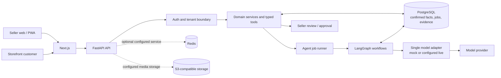

<div align="center">

# BizSaathi

### The evidence-grounded AI co-pilot for small sellers

**AI proposes. Deterministic controls validate. Sellers approve.**

[](https://nextjs.org/)
[](https://react.dev/)
[](https://www.typescriptlang.org/)
[](https://tailwindcss.com/)
[](https://www.python.org/)
[](https://fastapi.tiangolo.com/)
[](https://www.postgresql.org/)
[](https://redis.io/)
[](https://www.langchain.com/langgraph)
[](https://www.docker.com/)

[Overview](#overview) · [How it works](#how-it-works) · [Metrics](#measured-metrics) · [Get started](#get-started) · [Verification](#verification)

</div>

---

## Overview

Small sellers often manage product details, customer questions, and marketing through photos, voice notes, and chat. Generic AI can help draft text, but can also invent prices, stock, or policies. BizSaathi is designed to assist with those workflows while keeping confirmed business facts and consequential decisions under seller control.

| Workflow | Assistance | Human and system safeguards |
|---|---|---|
| Product intake | Turns a product photo into a draft | Draft stays a suggestion until the seller confirms it |
| Content drafting | Creates copy from a seller brief and product details | Factual claims are checked against available evidence |
| Customer chat | Answers using tenant-scoped catalog and policy data | Unsupported or sensitive requests can be escalated |
| Job review | Shows status and sanitized workflow events | Traces exclude raw model reasoning |

**The database is the source of confirmed prices, stock, and policies—not the model.** BizSaathi does not autonomously publish to social channels, confirm payments, or change business policy. Social webhooks, real payment processing, and KYC are out of scope.

## How it works

The web app calls a FastAPI modular backend. The backend enforces authentication and tenant scope, reads confirmed facts from PostgreSQL, and coordinates agent workflows through LangGraph. Model output remains a proposal; deterministic checks and seller review gate consequential actions.



### Workflow controls

1. **Validate intake and identity** outside the model.
2. **Retrieve tenant-scoped context** from business records.
3. **Generate a proposal** through the configured model adapter.
4. **Verify evidence and policy** using deterministic checks.
5. **Escalate or request seller approval** when facts are uncertain or an action is consequential.
6. **Record observable outcomes** such as node, duration, and safe error code; do not record raw reasoning.

The runtime graph routes according to the requested work; not every catalogued or planned node is active. See [System architecture](docs/01-architecture.md) and [Product vision](docs/00-vision.md) for detailed diagrams, scope, and design principles.

### Technology

| Layer | Technologies |
|---|---|
| Web / PWA | Next.js App Router, React, TypeScript, Tailwind CSS |
| API / schemas | Python 3.12, FastAPI, Pydantic v2 |
| Workflows | LangGraph, typed state |
| Persistence | PostgreSQL, SQLAlchemy 2, Alembic |
| Supporting services | Redis; S3-compatible media storage |
| Quality checks | pytest, Ruff, mypy, ESLint, OpenAPI comparison, mock evaluations |

The [OpenAPI contract](contracts/openapi.json) is the API/web source of truth. Dependency versions and assumptions are documented in [docs/12-assumptions-risks-deps.md](docs/12-assumptions-risks-deps.md).

## Measured metrics

### Business and production impact

| Outcome | Current evidence | Status |
|---|---|---|
| Time saved | No matched manual-versus-assisted timing study | **Not yet benchmarked** |
| Cost saved | No comparable labor, provider billing, and hosting baseline | **Not yet benchmarked** |
| Production availability / performance | No production traffic or telemetry | **Not measured in production** |
| Live-model quality | No approved, labelled live evaluation | **Not evaluated** |

These are unknown outcomes, not zero-valued results. Live evaluation is not approved. Do not infer business savings or live quality from local tests or mock runs.

The tenant-scoped agent metrics endpoint is `GET /v1/metrics/agents?days=30` (owner/operator; 1–90 days). It reports job counts/status, success rate, workflow and node latency percentiles, node error events, and recorded model-call totals. Token counts and estimated provider cost remain `null` until actual usage and pricing data are collected. Its aggregation has been tested with controlled database fixtures, not production traffic.

## Get started

### Prerequisites

- Git
- Docker Desktop with Docker Compose
- For running services directly: Python 3.12 with `uv`, and Node.js with npm

The local demo defaults to mock mode; a live-model key is not required.

### 1. Clone and configure

```powershell
git clone https://github.com/ABHIRAM-DEVP/Bizsaathi.git
Set-Location Bizsaathi
Copy-Item .env.example .env
```

Edit `.env` before starting. Configure unique local database credentials, a private JWT signing secret, database/storage URLs, and the required storage settings. For Docker Compose, `DATABASE_URL` must address the database service at host `postgres`, port `5432`; for an API run directly on Windows, use `localhost` and the configured host port (default `5433`). URL-encode special characters in URL credentials. Keep `.env` private and never commit or share it. The example uses mock AI mode and needs no provider key.

### 2. Start the stack

```powershell
docker compose up -d --build --wait
docker compose ps
```

The backend container applies database migrations at startup. Once services are healthy:

| Service | URL |
|---|---|
| Web app | [http://localhost:3000](http://localhost:3000) |
| Login | [http://localhost:3000/login](http://localhost:3000/login) |
| API documentation | [http://localhost:8080/v1/docs](http://localhost:8080/v1/docs) |
| API readiness | [http://localhost:8080/v1/health/ready](http://localhost:8080/v1/health/ready) |

Create or sign in to a local account from the login screen. Local account registration is development-only, not production authentication. Stop the stack with `docker compose down`; database volumes are retained.

> **Configuration note:** `.env.example` contains blank required credentials and URLs. Copying it alone is insufficient; fill in required values before Compose startup. Optional MinIO also requires its port settings.

### Run the app without the frontend/backend containers

Start PostgreSQL and Redis and configure `.env` with host-accessible URLs. Then use separate PowerShell terminals:

```powershell
# Terminal 1: API and database migrations
Set-Location backend
uv run alembic upgrade head
uv run uvicorn app.main:app --reload --port 8080
```

```powershell
# Terminal 2: web app
Set-Location frontend
npm ci
npm run dev
```

Open [http://localhost:3000](http://localhost:3000). See [STARTUP_GUIDE.md](STARTUP_GUIDE.md) for additional setup notes.

## Test and validate

From the repository root:

```powershell
python scripts/runner.py guards
python scripts/runner.py check-fast
python scripts/runner.py check
```

`check` runs repository guards, backend unit tests, Ruff, mypy, frontend lint, and the frontend production build. Integration tests and mock evaluations are separate commands:

```powershell
Set-Location backend
uv run pytest tests/integration -q
uv run python -m app.evals.run --mode mock --split dev
uv run python -m app.evals.run --mode mock --split heldout
```

The mock evaluation runner does not call a live provider. Live evaluations are not implemented by this runner and should not be presented as completed.

## Verification

Local working-tree checks run on **2026-11-03**. Percentages below describe only the listed tests or mock cases—not seller benefit, production uptime, live-model accuracy, or code coverage.

| Check | Result |
|---|---|
| Backend unit tests | **236 passed / 236 executed — 100%** |
| Backend integration tests | **9 passed / 9 executed — 100%; 3 skipped** |
| Integration scenario execution | **9/12 — 75% executed**; this is not code coverage |
| Mock evaluations | **Dev 12/12 — 100%; held-out 4/4 — 100%**; mock plumbing only |
| Ruff / mypy | **Passed**; mypy checked 141 source files |
| Frontend ESLint / production build | **Passed**; Next.js generated 18 pages |
| Repository guards | **Passed**; secret scan clean, 16 eval cases validated, docs consistent |
| OpenAPI comparison | **Passed**; 49 paths, 52 operations |
| Frontend E2E | **Not configured**; no `npm test` script or frontend test files |

Three full-stack integration scenarios are marked skipped in the test source and are excluded from the executed-test pass rate. These results are local verification, not production certification. Code coverage, production availability, live-model quality, time saved, and cost saved have not been established.

## Repository map

| Area | Purpose |
|---|---|
| [backend/](backend/README.md) | API, services, persistence, agent workflows |
| [frontend/](frontend/README.md) | The single seller and customer web/PWA |
| [contracts/](contracts/README.md) | Shared OpenAPI contract |
| [docs/](docs/README.md) | Requirements, architecture, endpoint specifications, decisions |
| [evals/](evals/README.md) | Synthetic datasets, thresholds, reports |
| [scripts/](scripts/README.md) | Validation and repository utilities |
| [bizsaathi-kit/](bizsaathi-kit/README.md) | Reusable setup kit; not application runtime |
| [reference-ui/](reference-ui/README.md) | Static design references; not production UI |
