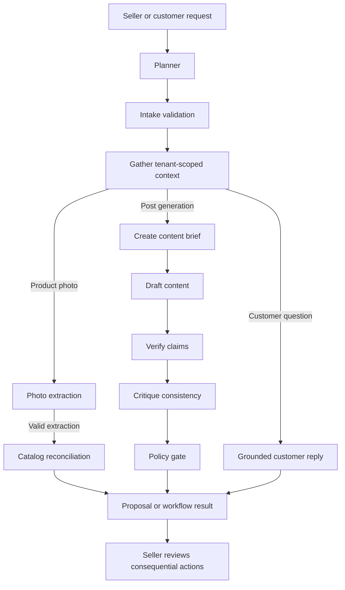
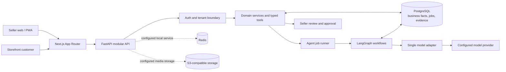

<div align="center">

# BizSaathi — The Seller's AI Co-pilot

### Evidence-grounded tools for small businesses

**AI proposes. Deterministic controls validate. Sellers approve.**

[](https://nextjs.org/)
[](https://react.dev/)
[](https://www.typescriptlang.org/)
[](https://tailwindcss.com/)
[](https://www.python.org/)
[](https://fastapi.tiangolo.com/)
[](https://www.postgresql.org/)
[](https://redis.io/)
[](https://www.langchain.com/langgraph)
[](https://www.docker.com/)

[Problem](#problem) · [Solution](#solution) · [Agent workflow](#agent-workflow) · [Metrics](#measured-metrics-and-impact) · [Get started](#get-started) · [Verification](#verification)

</div>

---

## Problem

Small sellers often manage products, stock, customer questions, and marketing through photos, voice notes, and chat messages. Generic AI can draft text, but it may invent a price, claim stock that is not available, or answer a policy question without evidence. Sellers need assistance without giving up control of their business facts or customer-facing decisions.

## Solution

BizSaathi is a mobile-friendly seller co-pilot for product intake, evidence-linked content drafts, and catalog-grounded customer replies. It combines AI proposals with database-backed facts, deterministic validation, and human review.

| Workflow | What BizSaathi does | Control |
|---|---|---|
| Product intake | Interprets an uploaded product photo into a draft | Draft is not a confirmed product; seller reviews it |
| Content drafting | Produces copy from a seller brief and available product details | Claims are checked against available evidence |
| Customer chat | Answers using tenant-scoped catalog and policy data | Unsupported or sensitive requests can be escalated |
| Job review | Records job status and observable workflow events | Trace data excludes raw model reasoning |

**Confirmed prices, stock, and policies come from the business database—not model output.** BizSaathi does not autonomously publish to social channels, confirm payments, or change business policy. Social webhooks, real payment processing, and KYC are outside the current scope.

## Agent workflow

The LangGraph runtime shares a typed state and routes work according to the requested workflow. The paths below describe the current graph, not a claim that every catalogued or planned agent is active:



The API and application layer enforce tenant scope and permissions outside the model. Workflow events record node, outcome, duration, and safe error codes. Retries and repairs are bounded. See [System architecture](docs/01-architecture.md) for broader design diagrams and [Product vision](docs/00-vision.md) for scope and principles.

## System architecture



The backend is a modular monolith. PostgreSQL is the source of truth. Redis and S3-compatible media storage are configured for local/deployment use; their presence in the design is not evidence of a cloud deployment.

## Technology

| Layer | Stack |
|---|---|
| Web / PWA | Next.js App Router, React, TypeScript, Tailwind CSS |
| API | Python 3.12, FastAPI, Pydantic v2 |
| Agent workflows | LangGraph, typed state |
| Database | PostgreSQL, SQLAlchemy 2, Alembic |
| Supporting services | Redis; S3-compatible media storage |
| Quality checks | pytest, Ruff, mypy, ESLint, OpenAPI comparison, mock evaluations |

The [OpenAPI contract](contracts/openapi.json) is the API/web source of truth. Dependency versions and open assumptions are listed in [docs/12-assumptions-risks-deps.md](docs/12-assumptions-risks-deps.md).

## Measured metrics and impact

### Business and production outcomes

| Outcome | Metric and calculation | Illustrative calculation only — not a BizSaathi result | BizSaathi status / evidence needed |
|---|---|---|---|
| Time saved | `(manual median minutes − assisted median minutes, including review) ÷ manual median minutes × 100` | 10 min manual vs. 7 min assisted = **30%** | **Not benchmarked**; collect matched timings for the same seller task |
| Cost saved | `(baseline cost per completed task − assisted cost per completed task) ÷ baseline cost per completed task × 100` | ₹100 baseline vs. ₹70 assisted, including labor, actual model billing, and allocated hosting = **30%** | **Not benchmarked**; collect comparable end-to-end costs |
| Production availability | `(scheduled observation minutes − unavailable minutes) ÷ scheduled observation minutes × 100` | 30 days with 3.6 hours unavailable = **99.5%** | **Not measured in production**; requires production monitoring and a stated observation window |
| Production performance | Report request throughput and p50/p95 latency; compare p95 change as `(baseline p95 − observed p95) ÷ baseline p95 × 100` | p95 800 ms to 600 ms = **25% lower p95 latency** | **Not measured in production**; requires production traffic, workload, and telemetry |
| Live-model quality | `(labelled outputs meeting a pre-defined acceptance criterion ÷ labelled outputs evaluated) × 100` | 18 of 20 labelled outputs pass = **90%** for that criterion and dataset | **Not evaluated**; requires approval, labelled cases, and recorded model/configuration |

**Important:** The example figures above show how to calculate percentages; they are hypothetical, not measured results, targets, or forecasts for BizSaathi. Actual business and production outcomes remain unknown until the required measurements are collected. Live evaluation is not approved.

### Verified quantitative evidence

| Indicator | Measured result | Scope |
|---|---:|---|
| Backend unit-test pass rate | **100% (236/236)** | Local automated unit suite |
| Backend integration-test pass rate | **100% (9/9 executed)** | Local integration suite; 3 additional full-stack tests are skipped and excluded from the denominator |
| Integration scenarios currently executed | **75% (9/12)** | 9 pass; the remaining 3 (25%) are explicitly skipped full-stack scenarios |
| Development mock-evaluation pass rate | **100% (12/12)** | Deterministic mock plumbing; not live-model quality |
| Held-out mock-evaluation pass rate | **100% (4/4)** | Deterministic mock plumbing; not live-model quality |
| Repository guards | **Pass** | Secret scan, 16-case dataset validation, and documentation consistency |
| Backend lint / typing | **Pass** | Ruff and mypy; 141 source files checked |
| Frontend lint / production build | **Pass** | ESLint and Next.js build; 18 pages generated |
| OpenAPI contract | **49 paths / 52 operations** | Generated contract matches checked-in contract |

The **75%** figure is the proportion of listed integration scenarios that execute; it is not code coverage or a product-quality score. Other percentages describe only the stated test/evaluation results. None measures seller time saved, cost reduction, production availability, or live-model quality. Do not present hypothetical percentage calculations as BizSaathi results.

For client reporting, replace the illustrative calculations with measured data and include the sample size, observation window, workload, and methodology. Report live-model quality per pre-defined criterion and dataset; report production availability alongside throughput and p50/p95 latency.

### What has been measured locally

| Check or metric | Result | Interpretation |
|---|---:|---|
| Development mock evaluation | **12/12 — 100% pass** | Deterministic mock plumbing only; not live-model quality |
| Held-out mock evaluation | **4/4 — 100% pass** | Deterministic mock plumbing only; not live-model quality |
| Backend unit tests | **236 passed / 236 executed — 100% pass** | Local automated tests; see [Verification](#verification) |
| Backend integration tests | **9 passed / 9 executed — 100% pass; 3 skipped** | Includes controlled fixtures; three full-stack tests are explicitly skipped |
| Integration scenario execution | **9/12 — 75% executed; 25% skipped** | Test execution status, not code coverage |
| Metrics aggregation | Tested with controlled database fixtures | Tenant isolation and percentile calculations; not production traffic |
| Model tokens / estimated provider cost | **N/A — not collected** | No fabricated tokens, model prices, or dollar savings |

The percentages above apply only to the listed tests or deterministic mock cases. They are not product accuracy, customer benefit, uptime, or production performance claims.

The agent metrics API is `GET /v1/metrics/agents?days=30` (owner/operator; 1–90 days). It reports tenant-scoped job counts and status, success rate, workflow/node latency percentiles, node error events, and recorded model-call totals. Token counts and estimated cost remain `null` until actual usage and pricing data are collected.

### Technical inventory

| Inventory measure | Observed value |
|---|---:|
| OpenAPI contract | 49 paths / 52 HTTP operations |
| Reference SQL schema | 32 tables (design reference, not a deployed-table count) |
| Synthetic evaluation dataset | 16 cases (12 dev, 4 held-out) |
| Logical nodes in architecture catalog | 15 (not all active in the runtime graph) |
| Test coverage percentage | Not collected |

## Get started

### Prerequisites

- Git
- Docker Desktop with Docker Compose
- A local `.env` file configured from [.env.example](.env.example)

For running services outside Docker, install Python 3.12 with `uv`, and Node.js with npm. Live model credentials are **not required** for the mock-mode local demo.

### 1. Clone and configure

```powershell
git clone https://github.com/ABHIRAM-DEVP/Bizsaathi.git
Set-Location Bizsaathi
Copy-Item .env.example .env
```

Edit `.env` before starting. Set unique local values for the database username, password and database name, and a private JWT signing secret. For the Docker Compose stack, set `DATABASE_URL` to use the Compose database host (`postgres`) and port `5432`; URL-encode special characters in credentials. If running the API directly on your host, use `localhost` and the configured host port (default `5433`) instead. Configure the required storage settings and keep all secrets in `.env`—never commit or share it. The example defaults to mock mode, so no provider key is needed.

### 2. Build and start the local stack

```powershell
docker compose up -d --build --wait
docker compose ps
```

The backend container applies database migrations at startup. When the services report healthy, open:

- Web app: [http://localhost:3000](http://localhost:3000)
- Login / local account: [http://localhost:3000/login](http://localhost:3000/login)
- API docs: [http://localhost:8080/v1/docs](http://localhost:8080/v1/docs)
- Readiness check: [http://localhost:8080/v1/health/ready](http://localhost:8080/v1/health/ready)

Create or sign in to a local account from the login screen. Local account registration is development-only; it is not production authentication. To stop the stack, run `docker compose down` (persistent database volumes are retained).

> **Development note:** The root `.env.example` contains blank required credentials and URLs. Copying it alone is not sufficient; configure the required values before Compose startup. The optional MinIO profile also requires its port settings.

### Run the web and API directly

Start PostgreSQL and Redis first, configure `.env` with host-accessible service URLs, then use separate PowerShell terminals:

```powershell
# Terminal 1 — from repository root; apply migrations before first run
Set-Location backend
uv run alembic upgrade head
uv run uvicorn app.main:app --reload --port 8080
```

```powershell
# Terminal 2 — from repository root
Set-Location frontend
npm ci
npm run dev
```

Open [http://localhost:3000](http://localhost:3000). See [STARTUP_GUIDE.md](STARTUP_GUIDE.md) for more local development detail.

## Test and validate

From the repository root:

```powershell
python scripts/runner.py guards
python scripts/runner.py check-fast
python scripts/runner.py check
```

The runner's `check` recipe covers guards, backend unit tests, Ruff, mypy, frontend lint, and frontend production build. Run integration tests and mock evaluation splits separately from `backend/`:

```powershell
Set-Location backend
uv run pytest tests/integration -q
uv run python -m app.evals.run --mode mock --split dev
uv run python -m app.evals.run --mode mock --split heldout
```

Mock results are free, deterministic plumbing checks—not live-model quality. Do not run live evaluations unless explicitly approved and configured with server-side credentials.

## Verification

Local working-tree checks run on 2026-11-03:

| Area | Result |
|---|---|
| Repository guards | **Pass** — secret scan clean; 16 evaluation cases valid; docs consistency checked |
| Backend unit tests | **236 passed, 0 failed**, 5 warnings |
| Backend integration tests | **9 passed, 0 failed, 3 skipped**; skipped full-stack tests are marked `skipif(True)` |
| Ruff | **Pass** |
| mypy | **Pass** — 141 source files checked |
| Frontend ESLint | **Pass** |
| Frontend production build | **Pass** — 18 pages generated |
| OpenAPI contract comparison | **Pass** — 49 paths / 52 operations |
| Mock evaluations | **Pass** — dev 12/12, held-out 4/4; mock only |
| Frontend E2E | **Not configured** — no `npm test` script or frontend test files |

These are local check results, not a production certification. Test coverage percentage, production availability, live-model quality, time saved, and cost saved have not been established.

## Repository map

| Folder | Purpose |
|---|---|
| [backend/](backend/README.md) | API, services, persistence, agent workflows |
| [frontend/](frontend/README.md) | The single seller and customer web/PWA |
| [contracts/](contracts/README.md) | Shared OpenAPI contract |
| [docs/](docs/README.md) | Requirements, architecture, endpoint specifications, decisions |
| [evals/](evals/README.md) | Synthetic datasets, thresholds, reports |
| [scripts/](scripts/README.md) | Repository validation and utilities |
| [bizsaathi-kit/](bizsaathi-kit/README.md) | Reusable setup kit, not application runtime |
| [reference-ui/](reference-ui/README.md) | Static design references, not production UI |
