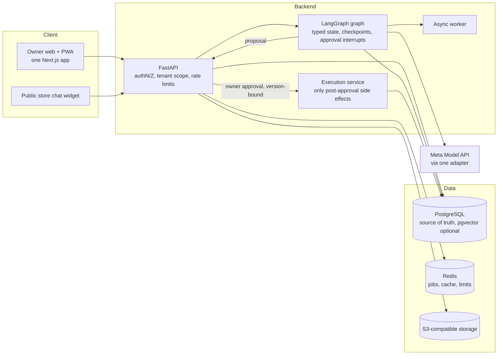
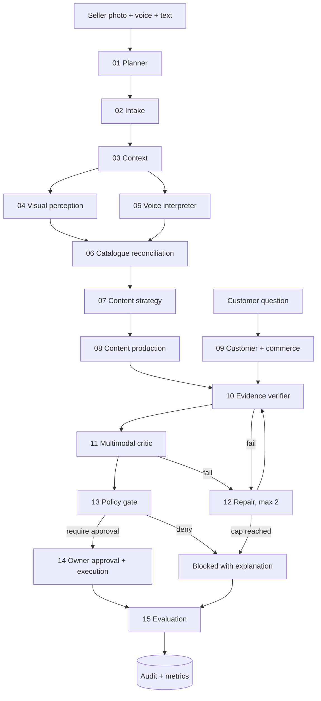
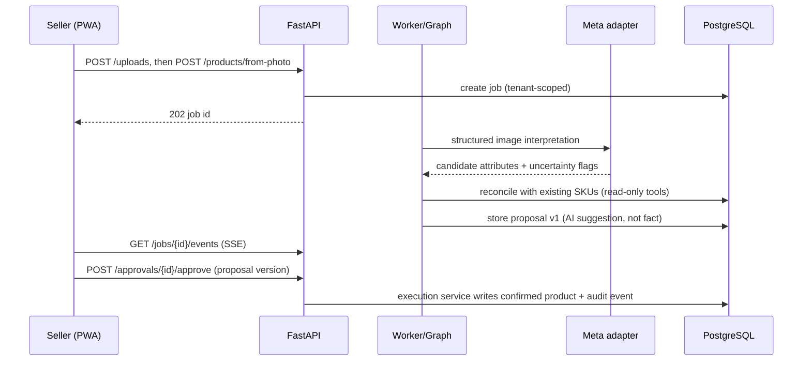
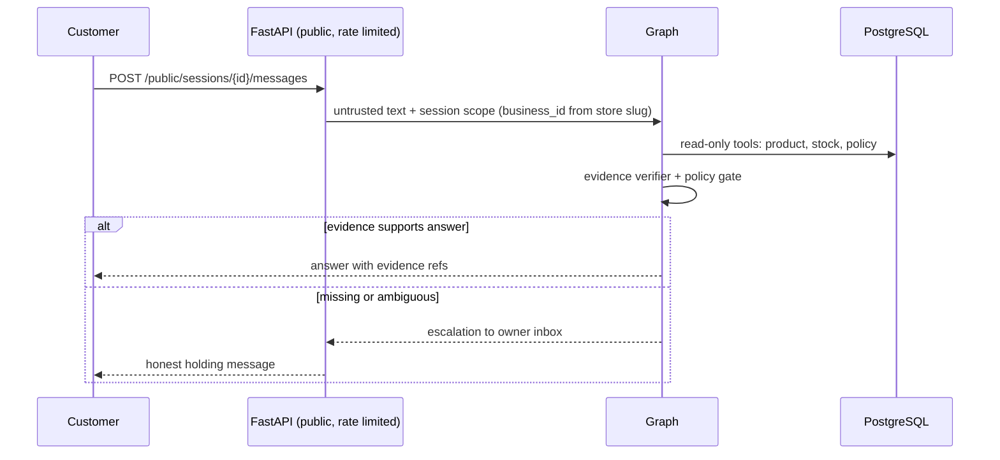

# 01 Architecture

Mermaid diagrams are the source of truth and live in git. ASSUMPTION: marks anything not verified.

## Containers (modular monolith + worker)

## The 15-node graph (conditional, not a chain)

Customer questions skip 02, 04-08 and go 09 -> 10 -> 13. Nodes 10, 11, 13 are different controls: facts, cross-modal consistency, permissions. No node certifies its own output.

## Sequence: photo to confirmed product

## Sequence: customer question

## Decisions
| Topic | Decision | Status |
|---|---|---|
| Shape | Modular monolith + worker; no microservices | ADR-0001 |
| Frontend | One Next.js app for web and PWA | fixed by brief |
| Models | Meta Model API behind adapter; IDs in config | IDs UNVERIFIED |
| Execution boundary | Model proposes, policy gate decides, owner approves, execution service acts | fixed |
| Retrieval | SQL tools for facts; pgvector/FTS only for unstructured policy text | optional |
| Observability | Structured logs, OpenTelemetry spans per node, observable events only | |
| Errors | Problem JSON `{type,title,status,detail,request_id}` | |

## Failure and retry
Timeouts per model call; retry transient errors only; max 2 repairs; model unavailable -> blocked state with manual-review path; fallback model never skips verification.

## Change rule
Any change to a diagram or the decisions table needs an ADR in docs/adr/.
