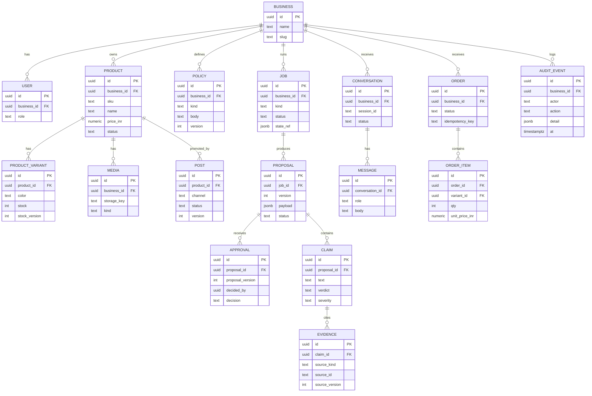

# 02 Data model

ASSUMPTION: entity set is a starting point; include only what the MVP needs. Every business-owned table has `business_id`.

## Conventions
- Keys: uuid. Timestamps: timestamptz UTC; `created_at`/`updated_at` everywhere.
- Facts vs suggestions: `PRODUCT` holds confirmed facts. AI output lives in `PROPOSAL.payload` until an approved write by the execution service.
- Evidence references product id, stock_version, policy version and source span.
- Orders: DRAFT -> AWAITING_PAYMENT -> PAID -> FULFILLED, plus CANCELLED and FAILED. Only the execution service transitions state.
- Tenant: repositories always filter `business_id`; consider RLS (needs ADR). Negative tests for every table.
- Retention: TODO define for media, transcripts, conversations. Redact PII before logs and model calls.

## Redis keys (ASSUMPTION)
| Pattern | Purpose | TTL |
|---|---|---|
| `job:{id}:events` | progress stream | 1h |
| `rl:public:{ip_or_session}` | public rate limit | window |
| `cache:{business_id}:product:{id}` | safe read cache | 60s |

## Indexes
| Table | Index | Serves |
|---|---|---|
| all tenant tables | (business_id, ...) | tenant-scoped queries |
| PRODUCT | (business_id, sku) unique | reconciliation |
| ORDER | (business_id, idempotency_key) unique | safe retries |
| AUDIT_EVENT | (business_id, at) | audit views |
