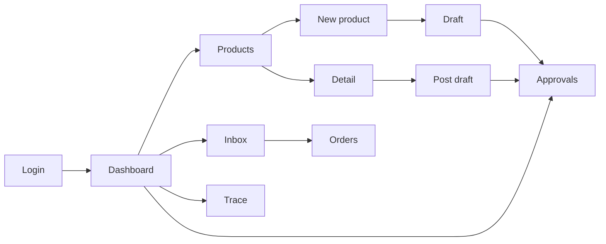

# 03 UI (one Next.js app: web + PWA)

## Strategy
Mobile-first responsive layouts, one codebase. PWA is explicit work (manifest, icons, service worker, install prompt, update flow, offline page). Cache the app shell and static assets only; never authenticated JSON.

## Routes (ASSUMPTION: names are proposals)
| Route | Purpose | Class | States |
|---|---|---|---|
| `/login` | OTP or dev login | MVP | loading, error |
| `/` dashboard | next step, pending approvals, recent jobs | MVP | all 6 |
| `/products` | list | MVP | all 6 |
| `/products/new` | photo (and voice) intake, job progress, draft review | MVP | all 6 + job stalled |
| `/products/[id]` | confirmed facts vs AI suggestions, edit | MVP | all 6 |
| `/posts/[id]` | draft, claim-check results, repair suggestions | MVP | all 6 |
| `/approvals` and `/approvals/[id]` | diff, evidence, warnings, approve/reject/edit | MVP | all 6 + proposal changed |
| `/inbox` | customer conversations, escalations | MVP-next | all 6 |
| `/orders` | order drafts and states | MVP-next | all 6 |
| `/s/[slug]` | public storefront + chat | MVP-next | all 6 |
| `/trace/[jobId]` | sanitized workflow trace, evidence | MVP | all 6 |
| `/evals` | scorecard | STRETCH | all 6 |
Six states: loading, empty, error, offline, permission-denied, success.

## Key interaction: AI vs confirmed
Every field shows a source badge: Confirmed (from database) or Suggested by AI (with confidence/uncertainty). Use label plus shape, not color alone. Conflicts (spoken price vs DB) show both values and require an explicit choice.

## Approval screen contract
Before/after diff, evidence list with ids, warnings, exact side effect, proposal version. If the proposal changes, Approve is disabled and the old approval is invalid.

## Navigation

## PWA behavior (verify with current docs)
- Installable: manifest + icons + HTTPS in deployed demo.
- Offline: shows cached shell and an honest message; server-backed actions say they need a connection.
- Update: when a new version is available, show a refresh prompt; do not break an in-progress approval.

## Accessibility
Labelled inputs, focus order, keyboard operation, contrast, reduced motion, error text not color-only.

## Wireframes
TODO: add sketches or links per MVP screen before Phase 4.
