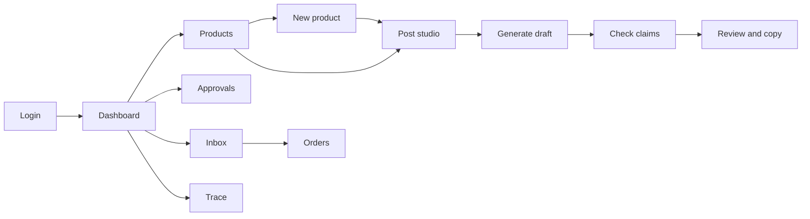

# 03 UI (one Next.js app: web + PWA)

## Strategy
Mobile-first responsive layouts, one codebase. PWA is explicit work (manifest, icons, service worker, install prompt, update flow, offline page). Cache the app shell and static assets only; never authenticated JSON.

The standalone design references in `reference-ui/*.dc.html` are visual specifications for the Next.js routes, not production pages or approved sample data. Reuse their seller shell, navigation, responsive card layouts, typography hierarchy, spacing and color tokens in `frontend/app`. Keep API-backed state and actions; never copy mock customer names, products, order states, verification badges or publishing claims into the live UI.

## Routes (ASSUMPTION: names are proposals)
| Route | Purpose | Class | States |
|---|---|---|---|
| `/login` | OTP or dev login | MVP | loading, error |
| `/` dashboard | next step, pending approvals, recent jobs | MVP | all 6 |
| `/products` | list | MVP | all 6 |
| `/products/new` | confirm product facts, save, continue to post creation | MVP | loading, error, success |
| `/posts` | choose product, generate draft, check claims, review and copy | MVP | loading, empty, error, success |
| `/products/[id]` | confirmed facts vs AI suggestions, edit | MVP | all 6 |
| `/posts/[id]` | draft, claim-check results, repair suggestions | MVP | all 6 |
| `/approvals` and `/approvals/[id]` | diff, evidence, warnings, approve/reject/edit | MVP | all 6 + proposal changed |
| `/messages` | tenant-scoped customer inbox, escalations, draft-only replies, synthetic widget preview | MVP-next | all 6 |
| `/orders` | order drafts and states | MVP-next | all 6 |
| `/s/[slug]` | public storefront + chat | MVP-next | all 6 |
| `/trace/[jobId]` | sanitized workflow trace, evidence | MVP | all 6 |
| `/evals` | scorecard | STRETCH | all 6 |
Six states: loading, empty, error, offline, permission-denied, success.

The public store shows its listed catalog and opens account-backed customer chat. The shop assistant can list the complete active catalog with saved prices, marks answers grounded in saved records, and refers unsupported or sensitive questions to the seller.

## Key interaction: AI vs confirmed
Every field shows a source badge: Confirmed (from database) or Suggested by AI (with confidence/uncertainty). Use label plus shape, not color alone. Conflicts (spoken price vs DB) show both values and require an explicit choice.

## Approval screen contract
Before/after diff, evidence list with ids, warnings, exact side effect, proposal version. If the proposal changes, Approve is disabled and the old approval is invalid.

## Navigation
The shared seller navigation follows the design references: Home, Posts, My Products, Messages, Orders and Approvals. Messages shows persisted owner conversations; in development, it starts clearly labeled synthetic demo threads. The widget preview and owner replies never send externally.

The Messages page supports browser-provided speech recognition for reply drafts only. The browser may use its own speech service; the transcript is shown for review and is never sent as a customer message. Unsupported browsers retain a normal typed-reply flow.

The guided product-to-post flow is `/products/new` → `/posts?product_id=<id>` → generate draft → check claims → review and copy. A successfully saved product continues to the post studio automatically; a failed photo upload stays on the form with a retry option. Product cards also open the post studio with their product selected. Route changes show a persistent seller shell and loading skeleton; page errors offer retry and Home navigation. The post studio's dotted progress indicator and next-step action reflect the current draft and claim-check version. Copying is manual; this flow does not approve, publish, schedule, or send content.

## PWA behavior (verify with current docs)
- Installable: manifest + icons + HTTPS in deployed demo.
- Offline: shows cached shell and an honest message; server-backed actions say they need a connection.
- Update: when a new version is available, show a refresh prompt; do not break an in-progress approval.

## Accessibility
Labelled inputs, focus order, keyboard operation, contrast, reduced motion, error text not color-only.

## Wireframes
TODO: add sketches or links per MVP screen before Phase 4.
